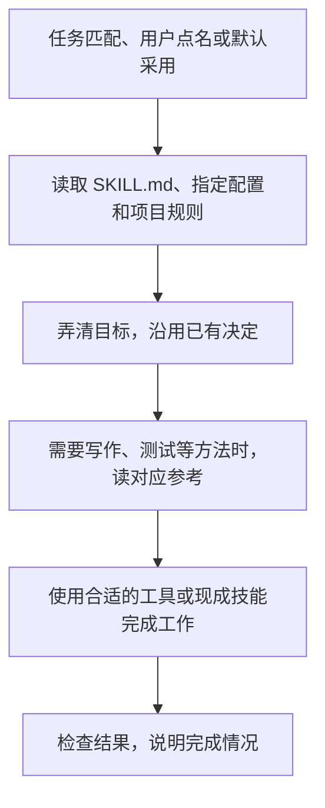

# 协作规约

给 Agent 用的一套协作约定，适合开发、写文档、做演示和需要多轮完成的任务。

它主要管几件容易出错的事：已经确定的做法，下次继续时要记得；用户指出一个问题，Agent 要检查其他地方有没有同类问题；改动涉及多个模块，要做到用户能实际使用；准备交付时，要说清做了什么、检查过什么、还有什么没完成。已有功能的明确缺陷直接修；新增未授权的功能或出现未确认的重要取舍时，先让用户决定。

这份 README 帮你了解怎么用，也说明后续修改应该放在哪里。Agent 执行时读的是 [SKILL.md](skills/agent-collaboration-guide/SKILL.md)。

## 怎么用

安装后，在任务里加一句：

> 请按 agent-collaboration-guide 协作，帮我完成……

你也可以在宿主的用户或项目配置里把它设为默认技能。开始时给出目标、材料和已知限制即可，Agent 应自己查资料、找遗漏、安排必要工作。清楚的小事直接做；已有决定不重复问，尚未授权的新功能、使用方式或重要取舍才需要你判断。

## Agent 会读哪些内容

宿主会先把技能名称和 description 提供给 Agent。Agent 判断任务匹配，或收到用户点名、默认采用的约定后，再读技能正文；不是看到一个关键词就必定执行。



具体先读哪份配置，按宿主入口约定。例如入口要求先读本机偏好，就先读它。项目规则从项目自己的入口读取，参考文档只读当前需要的部分。继续同一任务时，没变的内容不用再读一遍。

做完后，Agent 根据你的反馈修正成果。你明确要求以后沿用的选择，记入本机配置；只针对这次的要求，留在当前任务。一次夸奖不代表所有内容都已验收，也不自动成为长期偏好。

这套指导依靠 Agent 阅读和执行。安装成功不保证每次都会正确使用，检查过文件和链接也不代表真实任务已经通过验收。[已有验证及其限制](docs/evidence.md)

## 有现成技能就先用

制作和检查方法优先用已有技能，协作规约负责记住你的要求、处理重要决定，以及检查最后是否做完。

| 要做的事 | 先看什么 |
| --- | --- |
| 制作网页 PPT | [guizang-ppt-skill](https://github.com/op7418/guizang-ppt-skill)，直接使用它的模板和脚本；需要可编辑 PPTX 时选具备该能力的技能，例如 `ppt-master` |
| 去套话、改进文风 | [human-writing-skills](https://github.com/whh110112/human-writing-skills)，选择适合技术说明或报告的模块，保留原文事实和约束 |
| 写测试、检查测试是否有效、处理反复出现的错误 | [prove-it](https://github.com/nagi-studio/skills/tree/main/skills/rookie/prove-it)，使用适合当前任务的通过标准和检查方法 |

Agent 应先读选定技能的说明，再实际使用其中的方法。没安装就如实说明；需要安装时给出具体建议，按已有授权处理，不把整个技能集合一次装上。已确定的目标、样稿和测试结果直接继续用，不因为换技能再问一遍。详细用法见[技能复用](skills/agent-collaboration-guide/references/recommended-skills.md)。

[技能与资料收藏](docs/resource-collection.md)是单独给你浏览的清单，包含更多发现入口。它不要求 Agent 在每次任务前通读。

## 安装和更新

将仓库中的 `skills/agent-collaboration-guide` 安装到宿主的技能目录；Codex 可以使用 `skill-installer`。已有安装时，从仓库运行更新器：

```bash
python3 skills/agent-collaboration-guide/scripts/update_install.py \
  skills/agent-collaboration-guide /path/to/skills/agent-collaboration-guide --init-local
```

更新器只复制公共文件，保留目标目录中的 `local/`。`--init-local` 只在缺少 `local/preferences.md` 时创建入口；加 `--dry-run` 可先检查目的地。其他安装器不一定保留私人文件，使用前要核对，必要时备份。

## 文件怎么分工，后续怎么改

| 位置 | 内容与读者 |
| --- | --- |
| README | 给使用者和维护者看：用途、使用过程、安装和维护 |
| [SKILL.md](skills/agent-collaboration-guide/SKILL.md) | 给 Agent 执行：何时使用、先读什么、做事时遵守哪些规则 |
| `references/` | Agent 需要时再读的写作、测试、代码、演示等方法 |
| 安装后的 `local/` | 个人选择、项目定位和私有记录；不进公共仓库或发布包 |
| `docs/` | 供查阅的收藏、例子、设计来源和验证记录 |

所有任务都用得到的规则改在 SKILL.md，只有某类任务需要的细节放对应参考。个人选择留在本机，项目事实和规则以项目自己的文档为准。改变技能触发、读取、复用或验收方式时，同时核对 README 的说明，避免介绍和实际规则说两套话。

公开打包从仓库中的公共目录导出，不直接打包整个已安装目录。配置迁移和多宿主使用见[本地配置与维护](skills/agent-collaboration-guide/references/local-profile.md)。

当前版本 **0.8.14**，以 SKILL.md 元数据为准。仓库是维护源，本机安装是副本，不必每次任务都联网更新。

[修订记录](CHANGELOG.md) · [设计与来源](docs/design-and-sources.md) · [使用示例](docs/examples.md) · [MIT 许可](LICENSE) · [第三方说明](THIRD_PARTY_NOTICES.md)

早期[原始理念](skills/agent-collaboration-guide/references/principles-original.md)保留作历史资料，不作为另一套现行规则。
