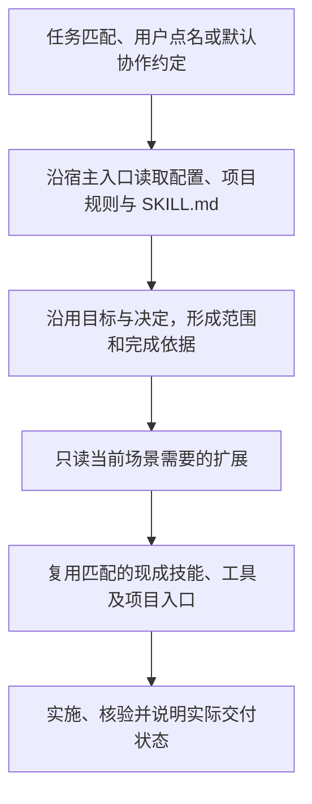

# 协作规约（Agent Collaboration Guide）

一个面向人机协作的 Agent Skill：让 Agent 沿用已经确定的目标与决定，主动补足必要场景、完成关联交接，并拿实际证据说明交付状态；用户保有方向和重要取舍的控制权。适合需求讨论、长任务接续、技术解释、开发验证与结果复核，清楚的小请求直接完成。

这份 README 面向准备使用或维护规约的人，介绍用途、运行逻辑和维护分工。给 Agent 执行的规则维护在 [SKILL.md](skills/agent-collaboration-guide/SKILL.md)；两份文档描述同一套逻辑，README 不复制整套执行条款。

## 怎样开始使用

安装后，可以在任务中点名 `agent-collaboration-guide`。希望默认采用时，在宿主支持的用户／项目入口中明确约定；本机偏好与项目规则从各自指定入口读取，不依赖 Agent 每次猜中描述。

先提供目标、已有材料与确定的限制即可，不必先替 Agent 拆完所有常规步骤。Agent 应自行梳理完成条件、查明事实并推进授权内工作；涉及未确认的重要取舍才说明影响与选项，已确认且条件未变的内容直接沿用。准确边界见 [执行入口](skills/agent-collaboration-guide/SKILL.md#开始先形成完整骨架)。

## 一次任务怎样运行

宿主通常先向 Agent 提供技能名称和描述，Agent 根据请求匹配，或按用户点名、已采用的默认协作约定使用技能。随后由 Agent 读取文件、选择工具并执行；本仓库提供指导，不包含自动调度或运行时强制服务。



指定的宿主入口可以要求先读本机配置，再核对 `SKILL.md`；项目事实与约束从目标项目入口读取。场景扩展只补当前任务需要的内容，已经核对且未变的资料沿用，不要求每轮读取全部文件。

例如制作网页演示时，用现成制作技能的模板和脚本，本规约补受众、目标、重要取舍及验收衔接；设计测试或复核反复问题时，选用适配的测试与证据技能。具体选用维护在[技能复用入口](skills/agent-collaboration-guide/references/recommended-skills.md)，不在这里复制另一份技能清单。缺少匹配技能且确有收益时，建议具体安装；没有安装授权不擅自安装，现有工具足够时直接完成。

交付时区分已实现、已验证、未完成及其影响；后续反馈融回相应任务、项目或个人选择。一次认可不自动变成全部验收或长期偏好，没有新信息不例行提问。

不同宿主的发现、默认采用和权限行为可能不同；名称描述、文件存在或安装成功都不保证每次正确触发与执行。结构检查、运行验证、用户理解与业务验收分别说明，效果边界见[现有证据](docs/evidence.md)。

## 文件分别给谁读

| 文件／位置 | 主要读者 | 负责什么 |
| --- | --- | --- |
| 本 README | 使用者与维护者 | 了解用途、运行过程、安装和维护分工 |
| [SKILL.md](skills/agent-collaboration-guide/SKILL.md) | 执行任务的 Agent | 适用判断、读取范围、通用执行规则与场景路由；执行规则的统一入口 |
| `skills/agent-collaboration-guide/references/` | 当前场景中的 Agent；按需查阅的维护者 | 写作、测试、代码、演示等场景增量，不是必读全套流程 |
| 安装目录的 `local/` | 当前用户与处理相关任务的 Agent | 个人选择、项目约定和私有历史；不随公共仓库发布 |
| [技能与资料收藏](docs/resource-collection.md) | 想浏览、比较资源的用户 | 仅供收藏与自行选择，不参与默认执行阅读链 |
| `docs/` 中的设计、证据与示例 | 维护者及需要追查依据的使用者 | 来源、设计取舍、验证范围与案例，不充当另一套执行规范 |

## 安装与更新

把仓库里的 `skills/agent-collaboration-guide` 目录安装到宿主的技能目录；Codex 可用 `skill-installer` 从本仓库安装。已有安装时使用下列保留流程，不先删除整个安装目录。

从仓库运行：

```bash
python3 skills/agent-collaboration-guide/scripts/update_install.py \
  skills/agent-collaboration-guide /path/to/skills/agent-collaboration-guide --init-local
```

加 `--dry-run` 先核对公共文件目的地；`--init-local` 仅在缺少 `local/preferences.md` 时建立入口。已有私有目录不会被读取或覆盖，更新器不删除目标目录里的其他内容。此保证仅适用于本更新流程；其他安装器先核对保留行为，必要时备份。

配置也可放在宿主或项目已指定的位置；不为统一目录擅自搬动资料。迁移和多宿主入口见[本地配置与维护](skills/agent-collaboration-guide/references/local-profile.md)。

## 后续怎样维护

通用执行规则改 `SKILL.md`，仅特定场景需要的细节改已有扩展，并保持路由能找到；个人选择与私有上下文留本机配置，项目事实和约束以目标项目入口为准，不另复制一份真源。README 维护读者理解所需的运行模型和文件分工，不重复列全部执行条款。改变触发、读取、复用、反馈或验收逻辑时，同步审视 README 的说明与实际执行入口，不能让介绍与规则各自演进。

清楚的小修不扩成流程重构；较大修订按原始用户要求复核，同时检查遗漏、越权、重复确认和维护负担。验证范围、版本与未验证部分如实记录，不用规则数量或审阅通过声称长期效果已获证明。

当前版本 **0.8.13**，以 SKILL.md 元数据为准。本仓库是维护源，安装目录是发行副本，日常使用不必每次联网更新。`local/` 与私有历史不提交或打入公共包；导出从公共源进行，不直接打包整个已安装目录。

- [修订记录](CHANGELOG.md)
- [验证与已知限制](docs/evidence.md)
- [来源与设计取舍](docs/design-and-sources.md)
- [使用示例](docs/examples.md)
- [MIT 许可](LICENSE) 与[第三方说明](THIRD_PARTY_NOTICES.md)

更早的协作母本已退役；[原始理念](skills/agent-collaboration-guide/references/principles-original.md)仅作历史背景，不作为另一套入口。
