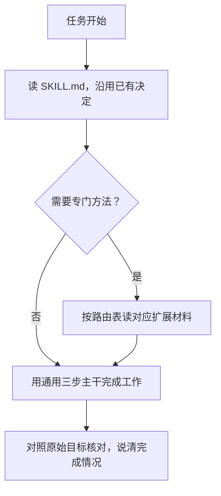

# 协作规约

和 Agent 协作时，这些问题最常出现：确认过的做法下次被忘了；你指出一个问题，同类的问题没人查；改了很久，结果还是取不回来；你不知道到底做完了没有。

这个技能处理这些问题。它不管你在做什么任务，只管协作过程的质量。

## 用了之后，协作会有什么不同

- **不用重复背景**：已经确认的决定、已经讨论清楚的取舍，Agent 会记住并沿用，不在下轮重新问
- **一个问题，检查同类**：你指出某处有问题，Agent 会检查其他地方有没有同样的问题，不只修你指的那一处
- **追踪到结果，不汇报过程**：Agent 会确认成果真的可以取回和使用，而不是用"我运行了命令"代替"结果可用了"
- **说清做了什么、没做什么**：交付时主动说明哪些验证过、哪些没有、哪些没完成，不让你猜

## 怎么用

安装后，在任务里说：

> 请按 agent-collaboration-guide 协作规约，帮我完成……

也可以在宿主配置里设为默认，之后不用每次点名。

给出目标、已有材料和已知限制就够了。尚未授权的新功能或重要取舍才需要你判断，其他的 Agent 自己处理。

## 有现成技能就先用

这个技能管协作质量，制作和检查方法优先用专门的技能：

| 要做的事 | 先用什么 |
| --- | --- |
| 制作网页 PPT | [guizang-ppt-skill](https://github.com/op7418/guizang-ppt-skill) |
| 去套话、改进文风 | [human-writing-skills](https://github.com/whh110112/human-writing-skills) |
| 写测试、检查测试是否有效 | [prove-it](https://github.com/nagi-studio/skills/tree/main/skills/rookie/prove-it) |

更多资源见[技能与资料收藏](docs/resource-collection.md)。

## 安装和更新

将仓库中的 `skills/agent-collaboration-guide` 安装到宿主的技能目录。已有安装时运行更新器：

```bash
python3 skills/agent-collaboration-guide/scripts/update_install.py \
  skills/agent-collaboration-guide /path/to/skills/agent-collaboration-guide
```

首次安装加 `--init-local` 创建私有配置入口；`--dry-run` 可先预览。更新器只复制公共文件，保留 `local/`。

---

<details>
<summary>Agent 读哪些内容</summary>

宿主先把技能名称和 description 提供给 Agent。Agent 判断任务匹配后读 SKILL.md，按需跳转到对应的扩展材料，继续同一任务时已读内容沿用。



</details>

<details>
<summary>文件分工</summary>

| 位置 | 内容 |
| --- | --- |
| README | 给使用者：协作改变了什么、怎么用、安装 |
| [SKILL.md](skills/agent-collaboration-guide/SKILL.md) | 给 Agent：通用底线三步 + 路由表 |
| `references/` | 写作、测试、代码、演示等专门方法，按需读取 |
| 安装后的 `local/` | 个人选择和私有记录，不进公共仓库 |
| `docs/` | 收藏、例子、设计来源和验证记录 |

</details>

---

当前版本 **0.8.14**，以 SKILL.md 元数据为准。

[修订记录](CHANGELOG.md) · [设计与来源](docs/design-and-sources.md) · [使用示例](docs/examples.md) · [MIT 许可](LICENSE)
